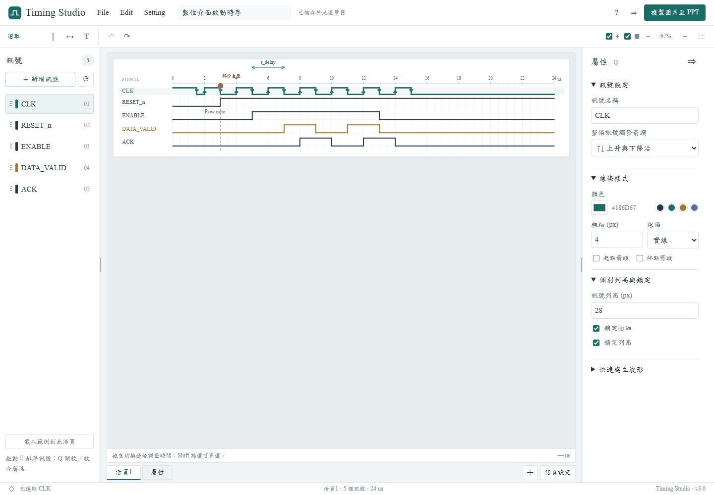

# Timing Studio

數位 Timing Diagram 網頁編輯器。直接編輯高低電位、拖曳切換時間、對齊多條訊號，並將時序圖複製到 PowerPoint。v3 整理為 File／Edit／Setting 選單，提供全活頁 Diagram 設定、個別波形鎖定、自訂快捷鍵與中英文介面。



## 開始使用

開啟 `public/index.html` 就能離線繪圖與下載圖片；檔案必須與同目錄的 JS、CSS 放在一起。

使用本機網址時，先安裝 Node.js 20 以上版本，再雙擊 Windows 的 `start.cmd`，或在專案目錄執行：

```sh
node scripts/serve.cjs
```

在瀏覽器開啟 [Timing Studio](http://localhost:4873)。保持執行伺服器的視窗開啟。程式沒有建置步驟，也不需要安裝執行相依套件。

## 已有功能

- 新增、複製、刪除與拖曳排列訊號，每頁最多 64 條；跟隨訊號的文字與列上方箭頭一起移動。
- Excel 式活頁分頁，每份圖檔 1–32 頁；可設定頁數、命名、複製、刪除，並用復原還原。
- File → Import 可取代圖檔或加入為新活頁；Export 集中設定 PNG、SVG 和可編輯圖檔輸出。
- Edit 提供選取、切換、H／L／X／Z 及複製貼上操作；上方圖示列保留參考線、時間箭頭與文字等常用工具。
- 點擊格子翻轉 H/L；拖曳塗畫高電位、低電位、X 與 Z。
- 波形序列輸入，例如 `00111000XXZZ1100`。
- 依週期、占空比、起始時間、閒置電位產生時脈；占空比表示每個週期中高電位的比例。
- 拖曳切換邊緣，格線吸附與其他訊號邊緣吸附；Alt 拖曳暫時關閉吸附。
- Shift 多選切換邊緣，一起平移或對齊到指定時間；保護相鄰邊緣，避免順序交錯。
- 線條粗細、顏色、實線、虛線、點線與起點／終點箭頭。
- Rising／falling 箭頭尖端直接疊在波形垂直切換線上；整條訊號選擇上升沿、下降沿或兩者，個別切換邊緣可選擇顯示、隱藏或依整條設定。
- 垂直參考線、可調整兩端的時間箭頭、可移動文字標註。
- 時間箭頭可獨立勾選顯示標註文字與時間差；關閉顯示仍保留原文字。
- 訊號列高 24–128 px，數值與滑桿設定，獨立調整波形高度 8–64 px；提供極緊湊／緊湊／標準快捷設定。
- Setting → Diagram 將時間軸、全域粗細、列高與波形高度套用所有活頁；右側可單獨設定波形粗細／列高，並分別鎖定以保留例外值。
- Ctrl+C／Ctrl+V 複製整條訊號，支援跨活頁貼上；包含線條樣式、觸發箭頭、個別列高與鎖定。Del 刪除、F 符合畫布。
- Setting 提供快捷鍵衝突檢查、恢復預設，以及繁體中文／英文模式；使用者輸入的名稱與標註保持原文。
- 繪圖與縮放工具集中在頂部，畫布與圖片移除可見的標題區。
- 左右側欄邊界可拖曳調寬，右側可收合；Q 切換屬性，H／L／X／Z／T 切換工具。
- 側欄寬度、收合狀態、目前活頁與每頁縮放視野可恢復。
- 屬性區塊可各自展開／收合；快速波形產生器預設收合，展開狀態與快捷鍵、語言偏好都可恢復。
- 復原／重做、瀏覽器自動保存、可編輯的 `.timing.json` 圖檔匯入與匯出。
- 2×／3×／4× PNG、SVG，以及白色／透明背景。輸出可選擇保留格線，編輯控制點一律移除。
- 中文標楷體，英文 Times New Roman。

詳細步驟請看 [操作說明](docs/usage.md)。

## 貼到 PowerPoint

1. 繪圖後按右上角「複製圖片至 PPT」。
2. 切換至 PowerPoint，按 `Ctrl+V`。
3. 貼上的是 PNG 圖片；需要修改波形時，回到 Timing Studio 修改後再次複製。Ctrl+C／Ctrl+V 在編輯器內複製訊號；複製報告圖片請使用「複製圖片至 PPT」。

圖片剪貼簿需要瀏覽器支援並允許寫入。建議從 localhost 或 HTTPS 網址使用；寫入被拒絕或功能未提供時，會顯示 PNG 下載按鈕，讓你將圖片插入 PPT。實作依據：[Clipboard.write](https://developer.mozilla.org/en-US/docs/Web/API/Clipboard/write)、[ClipboardItem](https://developer.mozilla.org/en-US/docs/Web/API/ClipboardItem/ClipboardItem)。

PNG 會使用本機實際可用的字型。請在使用的電腦安裝標楷體和 Times New Roman；缺少時，瀏覽器使用替代字型。SVG 保留字型名稱，未嵌入字型檔，換電腦後的顯示依該電腦字型而定。

## 放上 GitHub Pages

專案已附 [GitHub Pages 工作流程](.github/workflows/pages.yml)，尚未連接或上傳到任何 GitHub repository。

1. 在自己的 GitHub 帳號建立 repository，例如 `timing-studio`。
2. 將**此專案目錄內的內容**放在 repository 根目錄，包含 `.github`、`public`、`scripts`、`tests` 與 `package.json`。不要多包一層 `timing-studio` 目錄。
3. 使用 `main` 分支；到 **Settings → Pages → Build and deployment → Source** 選擇 **GitHub Actions**。
4. 在 **Actions → Publish Timing Studio** 手動執行工作流程，或推送更新至 `main`。驗證成功後，工作流程會發布 `public` 目錄。
5. 部署成功的網址會顯示在 Pages 設定與 Actions 的部署結果。

使用 Git 時可在此目錄執行，將網址換成自己的 repository：

```sh
git init -b main
git add .
git commit -m "Add digital timing diagram editor"
git remote add origin https://github.com/YOUR_ACCOUNT/timing-studio.git
git push -u origin main
```

部署設定依據 [GitHub Pages 官方工作流程文件](https://docs.github.com/en/pages/getting-started-with-github-pages/using-custom-workflows-with-github-pages)。圖檔保存在各使用者的瀏覽器或自行下載的檔案中；網站不會將波形圖上傳到 GitHub。

## 驗證

```sh
node --check public/app.js
node --check public/model.js
node --check public/render.js
node --check public/i18n.js
node --test tests/model.test.cjs
```

已通過 22 項模型／輸出測試與兩組實際 Chrome 瀏覽器操作驗證，包含全活頁套用與個別鎖定、不同列高的座標與標註、真正的跨活頁訊號剪貼簿、自訂快捷鍵、雙語切換、舊檔轉換、PNG 剪貼簿讀回、透明 PNG、有效 SVG 及手機版面。詳見 [驗證紀錄](docs/validation.md)。

選用的瀏覽器測試需要 Playwright；它不屬於程式的執行相依套件：

```sh
npm install --no-save --package-lock=false playwright
npx playwright install chromium
node tests/browser.cjs
node tests/interface.cjs
```

也可指定 `PLAYWRIGHT_MODULE_PATH` 和 `PLAYWRIGHT_EXECUTABLE_PATH`，使用既有 Playwright 與 Chrome。測試輸出放在忽略追蹤的 `output` 目錄。

## 結構與本版範圍

```text
public/                 可直接部署的網站
  index.html            操作介面
  styles.css            版面與字型
  model.js              波形資料、時脈、驗證與群組移動
  render.js             共用的畫布／SVG 輸出座標
  i18n.js               介面中文／英文翻譯
  app.js                互動操作、存檔、PNG 與剪貼簿
scripts/serve.cjs        本機伺服器
tests/                  模型與瀏覽器驗證
examples/               可開啟的範例圖檔
.github/workflows/      GitHub Pages 驗證及部署
```

時間軸採比例配置，時間值以 0.0001 單位精度儲存；格線可切換為 0.1、0.25、0.5、1、2、4 單位。縮短時間軸會裁掉超出的邊緣與箭頭，可用復原還原。

自動保存僅限目前瀏覽器與網址，並不取代圖檔備份。PNG 遇到大型圖會自動限制尺寸至 16,384 像素邊長及 3,200 萬總像素，以保持輸出可用；大型圖建議使用 SVG。

儲存會包含所有活頁，PNG／SVG／剪貼簿只輸出目前活頁。v1 單頁 `.timing.json` 與原本瀏覽器保存的圖形可自動轉成 v2 活頁；舊版瀏覽器保存鍵值保留不動。匯入圖檔上限為 16 MB。

範例：[單頁時序圖](examples/digital-startup.timing.json)、[多活頁與觸發箭頭](examples/multi-sheet.timing.json)。

新增範例：[全域設定與個別鎖定](examples/signal-locks.timing.json)，含 28 px 鎖定列與 40 px 一般列，以及跨活頁複製的波形。v3 延用 version 2 活頁格式，增加可選的 Diagram 與個別鎖定欄位；舊圖檔可直接開啟。

類比波形、資料匯流排值、自訂元件庫、PIN 腳與流程圖留待後續版本。PWL／CSV 輸出也尚未加入，匯出格式入口可供後續擴充。
